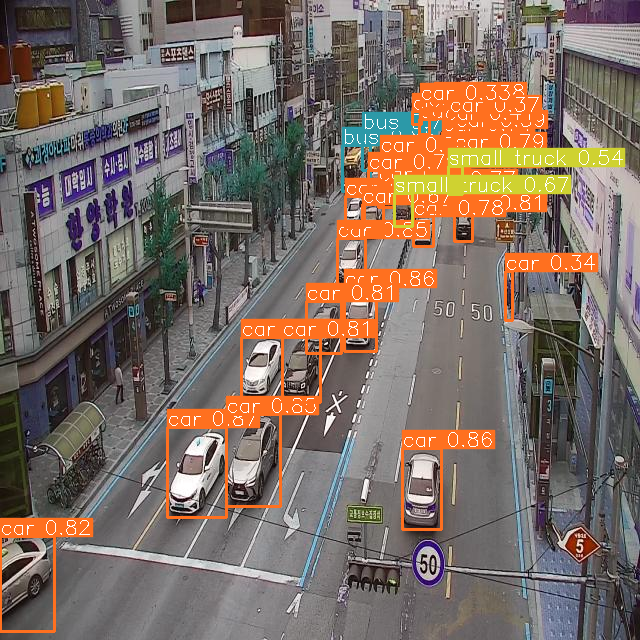
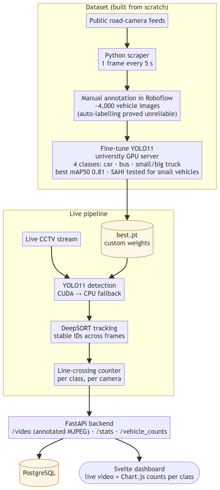

# Smart Traffic Monitoring: vehicle detection, tracking and counting on CCTV

> Educational project.



## Problem
Count vehicles by type on live city-camera streams. Generic detectors missed small, distant and partly hidden vehicles on Korean streets, and automatic labelling produced too many errors to train on.

## What it does
- **Dataset:** collected frames from public road-camera streams and hand-annotated about 4,000 images in Roboflow (4 classes: car, small truck, big truck, bus).
- **Training:** fine-tuned YOLO11 on a Linux GPU server and compared four training runs by mAP50.
- **Tracking and counting:** DeepSORT keeps one ID per vehicle across frames; a vehicle is counted once when its track crosses a virtual line. The direction comes from the sign of a cross product, so the script counts both directions.

## Results

| Run | Model | Input size | mAP50 |
|---|---|---|---|
| Best | YOLO11n, our dataset | 1024 | **0.81** |
| Larger model | YOLO11x, public dataset | — | 0.74 |
| Merged dataset | YOLO11x, our + public data | — | 0.74 |
| Deployed (fast) | YOLO11n | 640 | 0.61 |

The fast 640 model was the one deployed for live video, and it was weaker than the best run. The lesson: measure speed and accuracy together from the start. SAHI sliced inference was tested for small, distant vehicles in experiments; the final pipeline runs YOLO11 directly.



## How to run

```bash
pip install -r requirements.txt

# train (dataset exported from Roboflow in YOLO format)
python train.py --data data.yaml --model yolo11n.pt --imgsz 1024 --epochs 100

# count vehicles on a video file or a stream URL
python count_vehicles.py --weights best.pt --source video.mp4 --out out.mp4
```

The trained weights and the dataset are not included (file size and camera data). The counting line is horizontal at 62% of the frame height by default; change it with `--line-y`.

## Stack
Python, PyTorch, Ultralytics YOLO11, DeepSORT (`deep-sort-realtime`), OpenCV, Roboflow, SAHI (experiments)
